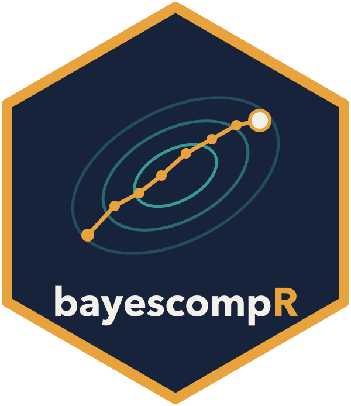

# bayescompR 

<!-- badges: start -->
[](https://github.com/adamrsophie/bayescompR/actions/workflows/R-CMD-check.yaml)
[](https://adamrsophie.github.io/bayescompR/)
<!-- badges: end -->

bayescompR is an independent implementation of the Stan probabilistic
programming language (version 2.40) written entirely in R. It parses and
type checks Stan programs, compiles them into R closures running on a reverse
mode automatic differentiation tape, and fits them with the No-U-Turn sampler
and the other Stan inference algorithms. No C++ compiler, CmdStan, rstan or
external inference engine is needed.

bayescompR is not affiliated with or endorsed by the Stan Development Team or
NumFOCUS. "Stan" refers to the language specification it implements.

## Installation

```r
# install.packages("remotes")
remotes::install_github("adamrsophie/bayescompR")
```

## Example

```r
library(bayescompR)

code <- "
data {
  int<lower=0> J;
  array[J] real y;
  array[J] real<lower=0> sigma;
}
parameters {
  real mu;
  real<lower=0> tau;
  vector[J] eta;
}
transformed parameters {
  vector[J] theta = mu + tau * eta;
}
model {
  mu ~ normal(0, 5);
  tau ~ cauchy(0, 5);
  eta ~ std_normal();
  y ~ normal(theta, sigma);
}
"
data <- list(J = 8, y = c(28, 8, -3, 7, -1, 1, 18, 12),
             sigma = c(15, 10, 16, 11, 9, 11, 10, 18))

model <- bayescomp_model(code, data = data)
fit <- bayescomp_sample(model, chains = 4, seed = 1, cores = 4)
fit
summary(fit, c("mu", "tau"))
bayescomp_diagnose(fit)
```

## What is included

| Area | Functions |
|------|-----------|
| Language | all program blocks, user functions (recursion, `_lpdf`, `_lp`, `_rng`, `_jacobian`), every constrained type including `sum_to_zero_vector`, stochastic matrices and Cholesky factors, truncation, `offset` and `multiplier` |
| Library | elementwise math, containers, linear algebra with analytic gradients, 66 distribution families (31 with lcdf and lccdf, 61 with rng) |
| MCMC | `bayescomp_sample()`: NUTS, static HMC, MALA, block or componentwise random walk Metropolis with adaptive covariance, slice sampling; diagonal or dense metric |
| More MCMC | elliptical slice sampling, `bayescomp_parallel_tempering()` (non reversible), `bayescomp_ensemble()` (DE MCMC, stretch move), `bayescomp_gibbs()` (blocked, with conjugacy detection), `bayescomp_riemannian()` (smMALA, RMHMC), `bayescomp_mclmc()`, `bayescomp_pdmp()` (Zig-Zag, BPS), `bayescomp_sgmcmc()` (SGLD, SGHMC), `bayescomp_rjmcmc()` |
| Sequential and evidence | `bayescomp_smc()` (tempered SMC with log evidence), `bayescomp_nested()`, `bayescomp_ssm()`, `bayescomp_particle_filter()`, `bayescomp_pmcmc()` (PMMH, particle Gibbs) |
| Approximations | `bayescomp_optimize()`, `bayescomp_laplace()`, `bayescomp_variational()` (ADVI), `bayescomp_pathfinder()` (also as MCMC initializer), `bayescomp_flow_vi()`, `bayescomp_ep()`, `bayescomp_inla()`, `bayescomp_npe()`, `bayescomp_diffusion()` (experimental), `bayescomp_generate_quantities()` |
| Model interface | `bayescomp_log_prob()`, `bayescomp_grad_log_prob()`, `bayescomp_constrain()`, `bayescomp_unconstrain()` |
| Diagnostics | rank normalized split R-hat, bulk, tail and quantile ESS, MCSE, divergences, tree depth, E-BFMI; trace, density, rank and ESS plots |
| Backends | typed versioned IR (`bayescomp_ir()`), backend registry with explicit fallback and `bayescomp_validate_backend()`; native backends bayescompRCranelift and bayescompRLLVM in [bayescomp-native-rs](https://github.com/adamrsophie/bayescomp-native-rs) |

Features of Stan that are not implemented yet (the `wiener` distribution)
give a clear
`bayescomp_unsupported_error` when the program is checked. See `vignette("stan-language")` for the full list.

## Speed

Everything runs in the R interpreter, so a gradient costs tens to hundreds of
microseconds, far slower than compiled Stan. Densities are
fused into single tape nodes with analytic partial derivatives, and the tape
avoids copying. For large models, the native backends compile the same IR
to machine code. See `vignette("performance")`.

## Which algorithm?

NUTS is the default for differentiable models. Pathfinder and Laplace give
fast approximations and good starting points. Tempered SMC and parallel
tempering handle multimodal posteriors and estimate the marginal likelihood;
nested sampling and reversible jump compare models. Metropolis, slice,
elliptical slice and ensemble samplers need no gradients. Gibbs sampling
draws conjugate blocks exactly. Particle MCMC handles state space models
with intractable likelihoods, NPE handles simulators, INLA latent Gaussian
models, and EP or SG-MCMC large data. `vignette("algorithms")` compares them
and `TODO.md` lists the roadmap.

## Documentation

The website <https://adamrsophie.github.io/bayescompR/> holds the reference
and these vignettes: getting started, the Stan language, inference
algorithms, diagnostics, automatic differentiation and transforms, backends
and the IR, performance, and validation.

## License

GPL (>= 3).
